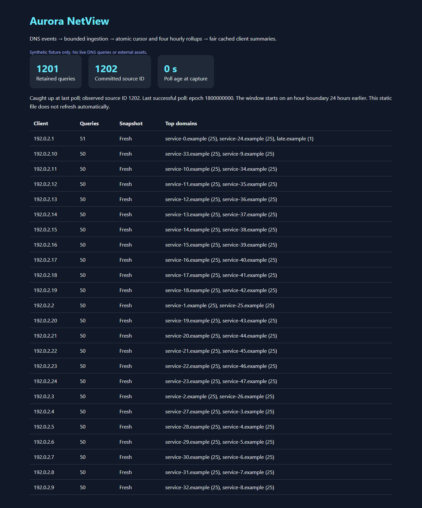
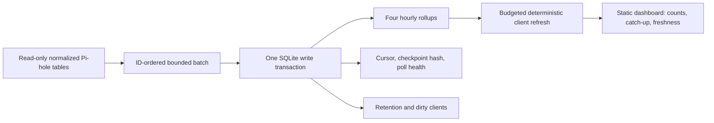

# Aurora NetView

Incremental DNS telemetry with a read-only Pi-hole database adapter, transactional SQLite rollups, and a small dashboard. The interesting part is keeping counts, checkpoints, retention, and cached client summaries consistent when polls overlap, events arrive late, or a process stops mid-commit.

This is a focused modernization of my Aurora NetView project. It retains the original four-rollup design and client-summary workflow; the source-ID cursor, failure contracts, deterministic summary scheduler, tests, and benchmark are new. [Provenance](PROVENANCE.md) separates those contributions.



## Try it offline

Python 3.11+; no runtime dependencies, database service, model, or network connection required. From a checkout:

```sh
python -m aurora_netview demo --out demo-run
python -m unittest discover -s tests -v
python checks/randomized.py
```

Open `demo-run/index.html`. The generated fixture contains 1,200 initial events, one late event sharing an earlier timestamp, and one expired event. The final four rollups exactly match an independent SQL recomputation: **1,201 retained queries, 1,202 committed source IDs, 24 clients**. The demo writes only to a new output directory and refuses to replace one that already exists. [Committed dashboard](demo/index.html) and [machine-readable capture](demo/report.json) contain synthetic data only.

For the installed command, run `python -m pip install .`, then `aurora-netview --help`.

## How it works



The rollups count queries per hour, domain/hour, client/hour, and client/domain/hour. Client identity is the source's address string, not its mutable display name. The writer acquires `BEGIN IMMEDIATE` before reading the cursor, then commits all four rollups, expiration, the checkpoint hash, and successful-poll health together. A retry after a failed transaction consumes the same IDs without counting them twice. Independent processes serialize through SQLite; there is no distributed coordination claim.

Client summaries are structured counts and top domains. Changed clients become dirty; unchanged empty polls do not invalidate them. Refresh chooses the least recently refreshed eligible clients first, with a stable client-name tie break and a fixed per-call budget. Expired clients disappear. The dashboard reports dirty/TTL-expired summaries, poll age, and whether the last bounded poll caught up to the source ID it observed. It is a static capture, not a streaming interface.

## Source and recovery contract

The adapter supports the normalized integer-reference subset documented in the [Pi-hole query database documentation](https://docs.pi-hole.net/database/query-database/): `query_storage(id, timestamp, domain, client)`, `domain_by_id(id, domain)`, and `client_by_id(id, ip)`. All three IDs must be SQLite `INTEGER PRIMARY KEY`; query IDs must be positive, increasing, and never reused within a configured source generation. Timestamps must be integer Unix seconds, with integer foreign-key references and nonempty joined labels. Extra columns are ignored. Legacy string references, missing tables/columns, orphan references, and future timestamps fail clearly. This is fixture-tested schema support, not a claim of compatibility with every Pi-hole release or a live installation certification.

```sh
python -m aurora_netview ingest --source source.sqlite --cache cache.sqlite --source-id deployment-generation-1 --batch-size 1000 --retention-hours 24
python -m aurora_netview refresh --cache cache.sqlite --limit 20
python -m aurora_netview view --cache cache.sqlite --out capture.html
```

`ingest` performs one batch. Repeat it while its JSON reports `remaining: true`, then schedule further polls. The source is opened with SQLite `mode=ro` and `query_only`; only the separate cache is writable. SQLite may require access to existing WAL/shared-memory sidecars when reading a live WAL database. No live database is opened by the demo, tests, or benchmark.

| Event | Defined behavior |
| --- | --- |
| New ID with equal or earlier timestamp | Count it if it falls in the retained window; timestamps do not drive the cursor. |
| Event older than retention | Advance the cursor and expired-on-arrival counter; do not resurrect expired counts. |
| Empty poll | Update successful-poll health and perform retention without invalidating unchanged summaries. |
| Crash before commit | Roll back counts and checkpoint together; replay safely on the next poll. |
| Overlapping pollers | SQLite serializes the complete read-cursor/write-count transaction. Busy timeout is 10 seconds; callers may retry. |
| Source ID regression, missing/changed checkpoint | Fail closed and preserve committed cache state. |
| Source replacement or in-place historical edits | Give the replacement a new source ID and use a new cache; retain the old cache separately. |
| Clock or retention configuration change | Reject backward poll/refresh clocks or a changed retention setting; use a new cache for a different retention policy. |

Pi-hole does not provide a database-generation marker in this supported schema. `--source-id` is therefore an explicit operator-managed identity. Never reuse it after replacement/reset. The bounded fast path validates the last consumed row, not every earlier row; arbitrary earlier updates, deletions, or dimension changes require verification and a rebuild. This limitation has a regression test. A source that prunes the checkpoint before the next poll also requires a rebuild. Rebuilds only reproduce events still present in the source; this tool cannot recover deleted history.

Retention includes the current partial hour plus the previous configured number of full hours (24 by default). New events are bounded to 1–100,000 rows per poll. Expiring rollup rows and affected clients is transactional but **not bounded by that batch size**; high-cardinality or large-expiry workloads can hold the single writer longer. Use a dedicated cache and local filesystem with SQLite locking semantics; this package does not provide automatic schema migration, daemon supervision, network serving, or alerts.

## Verification and measurements

```sh
python -m aurora_netview verify --source demo-run/source.sqlite --cache demo-run/cache.sqlite --now 1800000000
python benchmarks/run.py --out benchmark-new.json
```

Verification compares every key and count in all four rollups. Use the cache's successful-poll clock and retention policy, finish catch-up first, and verify against a source that still retains the corresponding events. Concurrent source changes can legitimately produce a mismatch; retry against a stable snapshot or rebuild after investigating.

The 28-test suite covers process interruption, two-process contention, empty polls, late/same-timestamp events, expiry boundaries, source mutation/reset, source immutability, alias protection, refresh fairness, monotonic clocks, and HTML escaping. An independently written seeded Python counter oracle checks another 96 checkpoints across eight generated histories; it does not reuse the SQL recomputation algorithm. CI runs both checks on Python 3.11 and 3.14 on Linux and Windows. A [recorded Chromium check](demo/browser-result.json) verified desktop/mobile rendering, 24 clients, catch-up labels, and no external requests. [Benchmark methodology and results](benchmarks/README.md) compare one incremental commit with four full SQL scans; they describe this small synthetic workload rather than production throughput.

MIT licensed. Pi-hole is an independent project; this repository is not affiliated with it. No Pi-hole source code, private DNS histories, deployment configuration, or original character/media assets are included.
